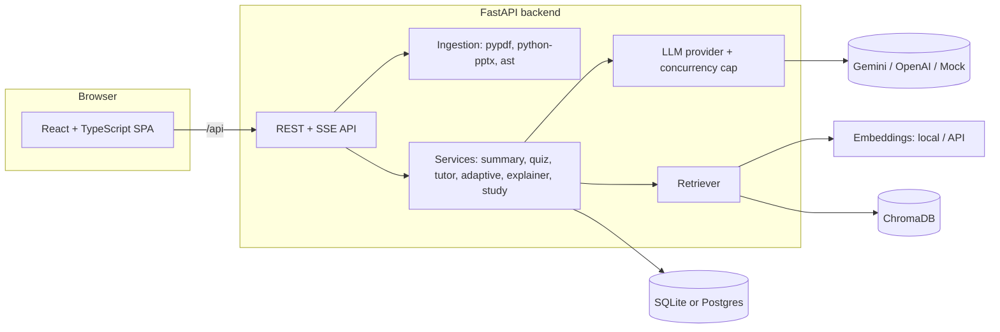

# MIK

A bilingual (Albanian / English) AI learning assistant for Computer Science students. Students
upload lecture material or source code and get level-adapted summaries and explanations, a
grounded tutor with citations, quizzes with adaptive re-explanation, and a spoken "Explainer Mode"
avatar walkthrough. A separate Study Mode experiment (`/study/participate`, `/study/return`; `/study` itself is a
study guide) runs a controlled experiment
comparing AI-assisted and unassisted study, with a researcher dashboard at `/admin`. The full
specification is in [PROJECT_SPEC.md](PROJECT_SPEC.md).

## Features

- **Ingestion**: PDF, PPTX, source code files and `.zip` code projects (Albanian or English),
  with size limits, zip-slip/zip-bomb protection and a clear error for scanned PDFs.
- **Summaries and explanations** adapted to beginner / intermediate / advanced level.
- **Grounded tutor** (RAG over your material) that cites sources; clicking a citation jumps to it.
- **Quizzes** (multiple choice and short answer) with per-topic mastery and weak-topic
  re-explanations.
- **Explainer Mode**: a spoken, section-by-section walkthrough by an animated avatar.
- **PDF export** of summary, explanation and quiz results (browser "Save as PDF", in the chosen
  language).
- **Study Mode**: consent, anonymous codes, block randomization, timed session, immediate and
  retention tests, questionnaire, withdrawal. Admin dashboard with statistics and CSV/JSON export
  (see [docs/STUDY_PROTOCOL.md](docs/STUDY_PROTOCOL.md)).
- **Bilingual UI** (SQ | EN), dark/light theme, keyboard and screen-reader friendly.

## Screenshots

_Placeholders: add images to `docs/screenshots/` and link them here._

| Landing page | Workspace | Explainer Mode |
| ------------ | --------- | -------------- |
| _(image)_    | _(image)_ | _(image)_      |

| Quiz results | Admin dashboard |
| ------------ | --------------- |
| _(image)_    | _(image)_       |

## Architecture



## Requirements

| Tool    | Version                   | Check              |
| ------- | ------------------------- | ------------------ |
| Python  | 3.11 or newer (3.12 used) | `python --version` |
| Node.js | 22 LTS (20.19+ works)     | `node --version`   |
| npm     | 10 or newer               | `npm --version`    |

## Setup and run

Use two terminals. Start the backend first.

### Backend (http://127.0.0.1:8000)

**Windows (PowerShell)**

```powershell
cd backend
py -3.12 -m venv .venv
.\.venv\Scripts\Activate.ps1    # if blocked: Set-ExecutionPolicy -Scope CurrentUser RemoteSigned
pip install --index-url https://download.pytorch.org/whl/cpu torch==2.9.1   # small CPU-only wheel
pip install -r requirements.txt
Copy-Item .env.example .env     # then set GEMINI_API_KEY
uvicorn app.main:app --reload --host 127.0.0.1 --port 8000
```

**macOS / Linux**

```bash
cd backend
python3 -m venv .venv
source .venv/bin/activate
pip install --index-url https://download.pytorch.org/whl/cpu torch==2.9.1
pip install -r requirements.txt
cp .env.example .env            # then set GEMINI_API_KEY
uvicorn app.main:app --reload --host 127.0.0.1 --port 8000
```

Check it at <http://127.0.0.1:8000/api/health> or the API docs at <http://127.0.0.1:8000/docs>.

### Frontend (http://localhost:5173)

```bash
cd frontend
npm install
npm run dev
```

The Vite dev server proxies `/api` to the backend (`VITE_BACKEND_URL` in `frontend/.env.local`
changes the target). Drop a PDF/PPTX/code file on the landing page to start.

### Docker

`docker compose up --build` (after copying `backend/.env.example` to `backend/.env`). See
[docs/DEPLOYMENT.md](docs/DEPLOYMENT.md), which also covers free-tier hosting.

## Environment variables

All backend settings are read from `backend/.env`; every variable is documented in
[backend/.env.example](backend/.env.example). The most important ones:

| Variable                                                             | Default                | Purpose                                                                                                                                     |
| -------------------------------------------------------------------- | ---------------------- | ------------------------------------------------------------------------------------------------------------------------------------------- |
| `LLM_PROVIDER`                                                       | `gemini`               | `gemini`, `openai` or `mock` (tests only)                                                                                                   |
| `GEMINI_API_KEY` / `OPENAI_API_KEY`                                  | –                      | Key for the chosen provider                                                                                                                 |
| `LLM_MAX_CONCURRENT_REQUESTS`                                        | `4`                    | Cap on simultaneous LLM calls                                                                                                               |
| `EMBEDDING_PROVIDER`                                                 | `local`                | `local`, `gemini`, `openai` (`hash` = tests only)                                                                                           |
| `DATABASE_URL`                                                       | SQLite file            | Use `postgresql+psycopg://...` in production                                                                                                |
| `CORS_ORIGINS`                                                       | localhost:5173         | Allowed frontend origins                                                                                                                    |
| `MAX_UPLOAD_MB`                                                      | `25`                   | Upload size limit                                                                                                                           |
| `QUOTA_DAILY_GEMINI_REQUESTS`                                        | `50`                   | AI (LLM) calls per browser per day, so the deployment stays within Gemini's free tier. Resets at the user's local midnight; `0` disables it |
| `QUOTA_DAILY_UPLOADS`                                                | `5`                    | Uploads (files or pasted code) per browser per day; same reset; `0` disables it                                                             |
| `ADMIN_PASSWORD`                                                     | unset                  | Enables `/admin` (disabled when empty)                                                                                                      |
| `APP_ENV`                                                            | `development`          | `production` makes cookies `Secure`                                                                                                         |
| `STUDY_SESSION_MINUTES`, `STUDY_RETENTION_DELAY_DAYS`                | `20`, `7`              | Study Mode timing                                                                                                                           |
| `STUDY_RETENTION_DELAY_DEV_MINUTES`                                  | unset                  | Dev override, never in a real study                                                                                                         |
| `FEATURE_STUDY_MODE`, `FEATURE_EXPLAINER_MODE`, `FEATURE_SERVER_TTS` | `true`, `true`, `true` | Feature flags                                                                                                                               |
| `TTS_CACHE_DIR`                                                      | `./data/tts_cache`     | Synthesized `.wav` files, content-addressed by text+language+model                                                                          |
| `TTS_CACHE_MAX_MB`                                                   | `500`                  | Disk cache eviction cap (oldest files first, once exceeded)                                                                                 |
| `HF_HOME`                                                            | `./data/hf_cache`      | Where the MMS-TTS model weights are downloaded and cached                                                                                   |

Frontend: `VITE_API_BASE_URL` (build-time backend URL when not using a proxy) and
`VITE_BACKEND_URL` (dev proxy target). **Never commit `.env`.**

### Voice (Avatar tab text-to-speech)

The Avatar tab's narration uses the backend's own neural voice (Meta's MMS-TTS,
`facebook/mms-tts-sqi` for Albanian and `facebook/mms-tts-eng` for English) by default
(`FEATURE_SERVER_TTS=true`) — it sounds like a real voice rather than the robotic quality of
browser text-to-speech, which matters most for Albanian, where installed system voices are rare.
If the backend voice is ever unavailable (not installed, still loading, or the request fails or
times out), the frontend automatically and silently falls back to the browser's own
`speechSynthesis`, so narration never just goes silent.

The first time each language is actually used, the backend downloads that language's model into
`HF_HOME` (`./data/hf_cache` by default) and loads it into memory. Measured against a fresh cache:
each model is ~139 MB on disk (~278 MB for both), and that first request took ~37s for Albanian
and ~20s for English (model download + load + the actual synthesis, all inside that one request).
Every request after that reuses the already-loaded model — a new sentence takes ~2s, and replaying
one already heard (cached in `TTS_CACHE_DIR` by a hash of its text + language + model version) is
near-instant (~15 ms). The cache is evicted oldest-first once it passes `TTS_CACHE_MAX_MB`
(default 500 MB). Set `FEATURE_SERVER_TTS=false` to skip the backend voice entirely and always use
the browser's.

## Tests, lint and build

Backend (from `backend/`, virtual environment active):

```bash
pytest
ruff check .
ruff format --check .
```

Frontend (from `frontend/`):

```bash
npm test              # Vitest unit/component tests
npm run lint          # ESLint + Prettier check
npm run build         # type-check + production build
npm run test:e2e      # Playwright end-to-end flow
```

The Playwright run (one-time `npx playwright install chromium`) starts its own backend and
frontend with `LLM_PROVIDER=mock` and `EMBEDDING_PROVIDER=hash`, so it is deterministic and needs
no API key. It covers upload → summary → quiz → tutor citation → language switch, plus a Study
Mode smoke test.

## Thesis objectives

| #   | Objective                                                  | Where it is implemented                                                                           |
| --- | ---------------------------------------------------------- | ------------------------------------------------------------------------------------------------- |
| 1   | Ingestion of PDF/PPTX and source code                      | `backend/app/ingestion/`, landing-page upload                                                     |
| 2   | Level-adapted summaries, explanations, code interpretation | `services/summary.py`, `prompts/`                                                                 |
| 3   | Interactive tutor grounded in the material                 | `services/tutor.py`, `rag/`, Tutor tab                                                            |
| 4   | Automatic quizzes (multiple choice and short answer)       | `services/quiz.py`, Quiz tab, `services/adaptive.py`                                              |
| 5   | Empirical evaluation support                               | `backend/app/study/`, `/study/participate`, `/admin`, [STUDY_PROTOCOL.md](docs/STUDY_PROTOCOL.md) |

## Languages

The UI language (`sq` or `en`) is chosen with the SQ | EN toggle and saved. All text lives in
`frontend/src/i18n/{sq,en}.json`; a test fails if their keys differ.

## Documentation

[STUDY_PROTOCOL.md](docs/STUDY_PROTOCOL.md) · [SECURITY.md](docs/SECURITY.md) ·
[DEPLOYMENT.md](docs/DEPLOYMENT.md)

## Known limitations

- Docker images are written but were not built or run in the final session.
- Free-tier hosting has ephemeral disks: use Postgres, and re-index documents (the Chroma index)
  after a redeploy unless a persistent disk is attached.
- The hash embedding provider and mock LLM exist for tests only; real quality needs a real model.
- The app palette is warm amber/cream rather than the indigo/violet named in the spec (an
  earlier-phase design choice); light-theme borders are lighter than WCAG's 3:1 non-text contrast.
- `npm audit` is clean, but `pip-audit` reports advisories in `chromadb` (server mode, not used)
  and `torch` (needs an untrusted checkpoint); see [SECURITY.md](docs/SECURITY.md).
- The admin login limiter is global, not per-IP; admin cookies need a single site (see
  DEPLOYMENT.md).
- The main JS bundle is still about 405 KB gzipped (syntax highlighter); admin/charts and
  Explainer are split out.
- Short-answer grading by the LLM and scanned-PDF OCR are not covered by automated tests with a
  real model.
